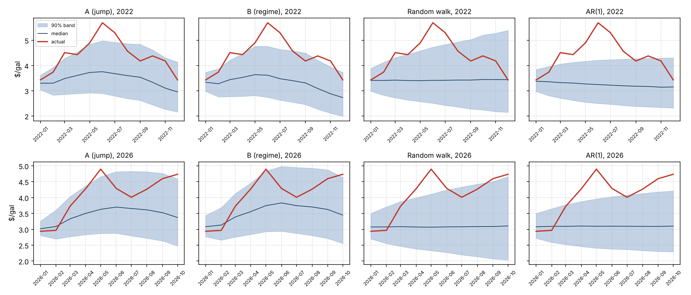

# EVs as Oil-Shock Insurance for Rideshare Drivers

ISE 599 Project 2 (USC, Fall 2026)

Full project outline: [`docs/outline.md`](docs/outline.md)

## Question

Which car should a Chicago rideshare driver drive, gas, hybrid or battery-electric, when gas prices can jump with no warning? We treat electrification as insurance: it costs extra in a normal year and pays off in a shock year. We measure the premium and the payout for different driver types, then add them up to a city-wide fleet mix and compare it with the real one.

Two shocks frame it. In 2022 gas spiked and fell back within months. In 2026 the Iran war started at the end of February and the US average went from $2.98 to $4.15 by early September, and stayed high. A good risk model has to handle both a short spike and a long one.

## Approach

1. **Data**: Chicago TNP open data (vehicles, trips, drivers), EIA gas, Brent and Illinois electricity prices, EPA fuel economy.
2. **AI-assisted cleaning**: an LLM matches messy make/model strings to EPA entries and labels the powertrain. We check it against a rule-based baseline and a hand-labeled sample.
3. **Price model**: two candidates fit on 2000-2025 weekly Chicago gas. A mean-reverting jump model (fits 2022) and a calm/crisis regime-switching model (fits 2026). Electricity and demand are simulated jointly with gas.
4. **Driver types**: group drivers by trips per month (light, regular, heavy) using the TNP vehicle data.
5. **Optimization**: two-stage stochastic program, one driver at a time. Stage 1: keep the current gas car, buy a hybrid, or buy an EV. Stage 2: which time blocks to drive each month (falling value per hour), with fuel or charging cost, charging time lost from good hours, and a cash constraint for the car payment. The tradeoff: an EV removes fuel risk but adds fixed cost and demand risk; a gas car keeps the option to drive less.
6. **Risk**: mean-superquantile (CVaR) objective. Sweep the risk weight to get a mean-risk frontier. The gap between the risk-neutral and risk-averse choice is the value of the insurance.
7. **Evaluation**: fit through 2025, then run the chosen cars through the real 2026 prices. Plus sensitivity to EV price premium, resale value, electricity price and jump size.

Key questions: Is a hybrid the cheaper hedge, and for which drivers? How much of the hedge is left if power prices and fares move with gas? How far is the real Chicago fleet from the model's mix, and why?

## Repo layout

```
src/
  step1_tnp_powertrain_share.py   data feasibility: monthly BEV / hybrid share of TNP vehicles
  download_data.py                pulls all other datasets into data/raw/
  step2_classify.py               powertrain label for every make/model/year (name rule, EPA, LLM)
  step2_validate.py               taxi fuel-type check + hand-label sample
  step3_drivers.py                driver types, hour-of-day revenue curve, reservation wages
  step4_gas_models.py             gas price models (spike / regime) and 2026 backtest
  step4_scenarios.py              joint gas, electricity, revenue scenarios + reduction
  step5_model.py                  two-stage stochastic program with CVaR
  step5_sweep.py                  where the best car flips as driving hours change
  step6_evaluate.py               sensitivity, break-even, 2026 backtest, fleet mix
  step7_validate.py               why these models: forecast benchmarks, recourse value, VSS, risk measure
tests/test_step5.py               LP vs hand calculations
data/
  README.md                       full data source list with links
  raw/  processed/                (git-ignored)
figures/
docs/
  outline.md                      project outline: question, data, model, AI use, critical assessment
```

## Validation: why these models

`python src/step7_validate.py` (about 15 seconds). Tables in `results/step7_*.csv`, full output in `results/step7_log.txt`.

**Forecast side**

| Check | Result | What it means |
|---|---|---|
| Jumps in weekly gas | Without a jump term the residuals have excess kurtosis 3.5 and 0.9% of weeks move more than 3 sd (normal: 0.27%). After taking out the 14 flagged jump weeks, kurtosis is about 0. | The jump term is needed, and one jump term is enough. |
| Benchmarks, 2026 (fit to 2025) | Mean CRPS: A 0.45, B 0.40, random walk 0.74, AR(1) 0.77. Months inside the 90% band: 80%, 80%, 50%, 40%. | Both gas models beat the simple benchmarks by a wide margin. |
| Benchmarks, 2022 (fit to 2021) | Mean CRPS: A 0.66, random walk 0.71, B 0.79, AR(1) 0.89. | A is still best. B does worse here because only four crises were known before 2022. All four models put the June 2022 peak above their 99th percentile. |
| Revenue random walk | SD of 12-month change: data 5.4%, AR(1) alone 5.4%, AR(1) + random walk 6.8%. SD of the 4-year average: 1.0% without the random walk, 4.9% with it. | Four years of data cannot tell the two apart at 12 months. The random walk is an assumption about persistence (the 2023 and 2026 drops lasted), not something the data prove. The "demand risk is about 3 times fuel risk" result depends on it. |
| Electricity elasticity | 2015–2025: 0.12 (t = 2.0). 2015–2019: 0.03. 2020–2025: 0.14. Neither sub-period is significant alone. | The link is weak and not stable. It matters little because the EV loses on charging time and fixed cost anyway. |



**Optimization side**

| Check | Result | What it means |
|---|---|---|
| Value of recourse | Setting hours after seeing each month's prices (vs. one fixed plan for all scenarios) is worth up to $830 in mean loss and $2,300 in CVaR for the gas car, about $0–280 for the hybrid. No car choice changes. | Flexible hours matter most for the gas car, which is the "option to drive less". The two-stage form is needed to measure that. |
| VSS | Planning with one average scenario picks the same car for every type, so VSS = 0 at both λ = 0 and λ = 1. | For the four driver types the stochastic program does not change the choice. Its value is in the risk numbers and in the 62–73 hour band where λ decides. |
| Mean-variance vs. mean-CVaR | Same car for every type and λ. Loss tails are close to normal (CVaR gap / normal CVaR gap = 0.86–0.96). | CVaR was picked because it measures the bad tail directly and keeps the problem linear, not because it gives a different answer here. |
| Hours response in 2026 | Model, gas car: hours fall about 30% with real 2026 prices and revenue. Data: trip-hours per active vehicle rose 1.8% (Jan–Sep 2026 vs. 2025). | The linear hours rule reacts far too strongly. Real drivers kept driving. This overstates the value of flexible hours and the gas car's option to drive less. |

## Run

Easiest: on GitHub, open the **Actions** tab → **Fetch data** → **Run workflow**. It runs the scripts on GitHub's servers and commits the aggregated results to `data/fetched/`. The trip tables are large, so they have their own workflow, **Fetch trips**: one job per year, saved month by month to `data/fetched/trips/`. If it stops part-way, run it again and it picks up the missing months. Add `EIA_API_KEY` (and optionally `SOCRATA_APP_TOKEN`) under Settings → Secrets and variables → Actions if you need electricity prices.

Locally:

```bash
pip install -r requirements.txt
python src/step1_tnp_powertrain_share.py
python src/download_data.py               # or: python src/download_data.py gas brent power
```

Environment variables:

- `SOCRATA_APP_TOKEN` (optional) avoids throttling on the Chicago portal. Free at https://data.cityofchicago.org/profile/edit/developer_settings
- `EIA_API_KEY` (needed for electricity prices). Free at https://www.eia.gov/opendata/register.php

## Status

- [x] Step 1 script: fleet powertrain mix over time
- [x] Download script for all datasets
- [x] Run step 1, check data quality and the share of ambiguous models
- [x] Powertrain labels (EPA + LLM) and taxi check
- [ ] Hand audit of the label sample
- [x] Driver types and revenue curve
- [x] Gas price models (jump vs. regime) + scenarios
- [x] Stochastic program + superquantile
- [x] 2026 backtest, sensitivity
- [x] Validation of the model choices (step 7)
- [ ] Slides
