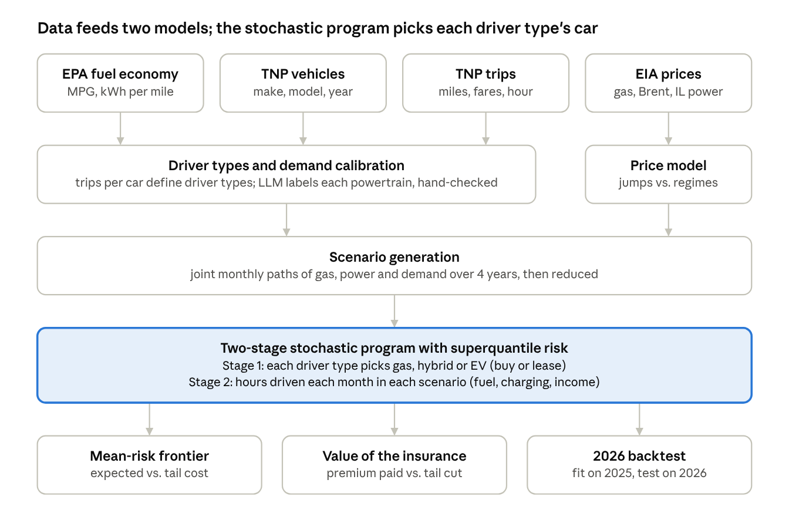

# Project Outline: EVs as Insurance Against Gas Price Shocks

ISE 599 Project 2, Fall 2026

## 1. Question and motivation

We ask which car a Chicago rideshare driver should drive, gas, hybrid or battery-electric, when gas prices can jump with no warning. We treat electrification as insurance. It costs extra in a normal year and pays off in a shock year. We put a number on both the premium and the payout for different kinds of drivers, then add the answers up to a city-wide fleet mix.

**Who decides.** Most rideshare drivers own their cars. In a 2016 Seattle driver survey (not a scientific sample), 78% owned, 6.8% leased through Uber or Lyft and 15% leased some other way ([Seattle](https://seattle.gov/Documents/Departments/FAS/RegulatoryServices/collective-bargaining/for-hire-driver-survey-summary.pdf)). So the real choice is made one driver at a time, and the driver carries the fuel risk. Uber's 2022 fuel surcharge was $0.45 to $0.55 per trip, which covered only part of the jump ([Uber](https://www.uber.com/us/en/newsroom/new-fuel-surcharge)). We split drivers into types by trips per month, solve each type's problem, and compare the implied city-wide mix with the actual Chicago fleet.

**Why now.** We have two shocks in five years, and they look different:

- 2022: after Russia invaded Ukraine, the US average peaked at about $5.01 a gallon, then fell back within months ([Eller](https://forecast.eller.arizona.edu/news/hormuz-crisis-and-gasoline-prices-how-does-2026-compare)).
- 2026: the Iran war started at the end of February. The US average went from $2.98 on Feb 28 to $4.15 on Sept 7, up 39% ([Al Jazeera](https://www.aljazeera.com/economy/2026/9/7/oil-prices-surge-as-us-iran-strikes-intensify-in-strait-of-hormuz)). Chicago was already at about $4.08 by mid-March ([UChicago](https://climate.uchicago.edu/news/as-gas-prices-in-chicago-rise-due-to-iran-war-commuters-face-mounting-costs/)).

The 2022 shock was a short spike, but the 2026 one has lasted for months. A risk model has to handle both kinds.

**Why it is more than "EVs save fuel".** The hedge is not perfect, for three reasons. A hybrid may give most of the protection at a much lower premium. Electricity prices can also rise in an energy crisis. And an EV brings its own risks: a higher purchase price, time lost to charging, and uncertain resale value.

## 2. Data

All of the data is public. The city data gives us the fleet and demand side. EIA gives us prices, and EPA gives us each car's fuel use.

| Dataset | Source | What we use it for |
| --- | --- | --- |
| TNP Vehicles, monthly | [Chicago portal bc6b-sq4u](https://data.cityofchicago.org/d/bc6b-sq4u) | Make, model, year and trips per car per month. Gives the powertrain mix over time, and the spread of trips per car that defines driver types |
| TNP Trips 2018-2022, 2023-2024, 2025 on | [m6dm-c72p](https://data.cityofchicago.org/d/m6dm-c72p), [n26f-ihde](https://data.cityofchicago.org/d/n26f-ihde), [6dvr-xwnh](https://data.cityofchicago.org/d/6dvr-xwnh) | Monthly trips, miles, fares and hour of day. Gives revenue per hour and whether fares moved with gas prices |
| TNP Drivers | [j6wf-834c](https://data.cityofchicago.org/d/j6wf-834c) | Active drivers per month, to check supply changes during shocks |
| Public passenger vehicle licenses (taxis) | [tfm3-3j95](https://data.cityofchicago.org/d/tfm3-3j95) | Lists fuel type, so it is a labeled set to check the powertrain labels |
| Weekly retail gasoline, Chicago (Midwest and US as backup) | EIA | Fit the gas price model. Weekly from 2000, so it includes 2005, 2008, 2022 and 2026 |
| Brent crude, daily | EIA | Higher-frequency view of the jumps |
| Average retail electricity price, Illinois, monthly | EIA | Charging cost, and how it moves with gas |
| Fuel economy by make, model and year | [EPA fueleconomy.gov](https://www.fueleconomy.gov/feg/download.shtml) | MPG and kWh per mile, plus a reference list for labeling each car's powertrain |

Known limits we will report rather than hide:

- The vehicle records have no trim field. "CAMRY" can be gas or hybrid, so for some popular models the powertrain is ambiguous. We will report the hybrid share as a range.
- There is no persistent vehicle ID, so we cannot follow a single car over time. We use model year as a stand-in for new cars entering.
- Purchase prices, maintenance and resale values are not in this data. We take them from published cost-of-ownership studies and test how sensitive results are to them.

## 3. Analytics pipeline

**Price model.** We fit two models to weekly Chicago gas prices from 2000 to 2025. One is a mean-reverting process with jumps, which fits short spikes like 2022. The other switches between a calm regime and a crisis regime, which fits long shocks like 2026. Electricity prices and demand are modeled together with gas, so the scenarios keep their correlation.

**Scenarios.** We simulate many monthly paths of prices and demand over a four-year holding period. Then we reduce them to a few hundred representative scenarios so the model solves fast.

**Two-stage stochastic program, one driver at a time.** Drivers don't affect each other, so we solve the problem from one driver's point of view and repeat it for each driver type.

Stage 1 is the car: keep the current gas car, buy a hybrid, or buy an EV.

Stage 2 is how the driver uses the car each month, once prices and demand are known. A simple "how many hours" decision would be trivial: with linear revenue and cost the driver either drives the maximum or not at all. So stage 2 has three tradeoffs built in:

1. **Hours have falling value.** From the hourly trip data we rank time blocks from best (evening peak, weekend nights) to worst. The driver fills the best blocks first, so each extra hour earns less. When gas gets expensive a gas-car driver drops the weakest blocks first, which is a real way to soften the shock.
2. **Fixed vs. variable cost.** An EV has a higher monthly payment but a low cost per mile. An old gas car has almost no fixed cost but its cost per mile moves with gas. The EV removes fuel risk but makes the driver more exposed to demand risk, for example a drop in fares or trips. The gas car keeps the option to drive less.
3. **Charging time competes with good hours.** Without home charging, an EV driver loses some hours to fast charging, and that grows with miles driven. Heavy drivers save the most on fuel but also lose the most time.

There is also a cash constraint. Each month, income minus costs has to cover the car payment and a basic living cost, and any shortfall is borrowed at a high rate. For a fixed car and scenario, stage 2 is a linear program; the falling value of hours enters as a piecewise-linear concave revenue curve.

L(x, ξ) is the driver's loss: minus the four-year net income, resale value included. We trade off average loss against tail loss using the superquantile (CVaR) at level α:

$$\min_{x \in X}\; (1-\lambda)\,\mathbb{E}\big[L(x,\xi)\big] + \lambda\,\bar q_\alpha\big(L(x,\xi)\big)$$

The Rockafellar-Uryasev formula computes the superquantile from the scenario losses:

$$\bar q_\alpha(L) = \min_{\eta}\Big\{\eta + \tfrac{1}{1-\alpha}\,\mathbb{E}\big[(L-\eta)^+\big]\Big\}$$

Setting λ = 0 gives the risk-neutral choice, and λ = 1 the most risk-averse one. The value of the insurance is the gap between them: how much average income the safer car gives up, and how much it raises income in the worst months. We repeat this for each driver type and weight by the number of drivers in each type to get the city-wide mix. Buying vs. leasing and home charging access are handled as sensitivity cases.

## 4. Questions we will answer

1. How much does the insurance cost and what does it pay? For each driver type we compare the car that is best on average with the risk-averse choice. The income given up is the premium. The gain in the worst 10% of outcomes is the payout.
2. Is a hybrid the cheaper hedge, and for whom? We expect light drivers to stay with gas or hybrid and heavy drivers to gain most from an EV. We look for the trips-per-month level where the answer flips.
3. How good is the hedge really? We test how much protection is left once electricity prices are allowed to rise with gas, and once fares are allowed to rise with gas (for example a fuel surcharge). If fares follow gas, gas cars are already partly hedged.
4. What would have happened in 2026? We fit everything on data through 2025, pick a car for each driver type, and then run those choices through the real 2026 prices. This is an honest out-of-sample test of the method.
5. Model vs. reality. We add the driver types up to an implied city-wide mix and compare it with the actual Chicago fleet. Where the gap is large, we discuss why: upfront cost, no home charging, or drivers not pricing the risk.
6. When does the answer flip? We find the break-even jump size and frequency, EV price premium and electricity price at which the best car changes.

## 5. How we use AI and how we check it

| Where | What the AI does | How we check it |
| --- | --- | --- |
| Data cleaning | An LLM matches messy make and model strings ("TOYOTA CAMRY HYB", "PRIUS PRIME") to EPA entries and labels each one gas, hybrid, plug-in or EV | We hand-label a random sample of a few hundred strings and use the taxi fuel-type labels. We report the LLM's accuracy against a simple rule-based baseline, and where it fails |
| Formulation | We give the AI the problem in plain words and ask for the two-stage model and the superquantile reformulation | We write down every error or missing assumption it makes and how we fixed it |
| Code | AI writes most of the data pipeline and model code | Small tests on known cases, for example a one-scenario model that must match a hand calculation |

## 6. Critical assessment we plan to do

- **Few shocks to learn from.** Even from 2000 on there are only a handful of big jumps, so jump frequency and size are poorly pinned down. We will show how the optimal choice moves across the plausible range, not just at the point estimate.
- **Model risk in the price process.** A jump model that snaps back fits 2022. A regime model fits 2026, where prices stayed high. We will solve under both and report how much the decision changes.
- **Data gaps.** Ambiguous hybrid models, no trims, no vehicle ID and the quarterly reporting lag. We will report results using the full range of possible hybrid shares.
- **Driver types, not drivers.** We group cars by trips per month, but the data does not link a car to a driver's income or home-charging access. We will say which of these could change the answer.
- **Assumed cost inputs.** Purchase price, resale value and charging downtime come from outside studies. We will run a sensitivity check and name the inputs that drive the result.
- **Scenario count.** We will check that the solution is stable as we add scenarios, and compare in-sample with out-of-sample cost.
